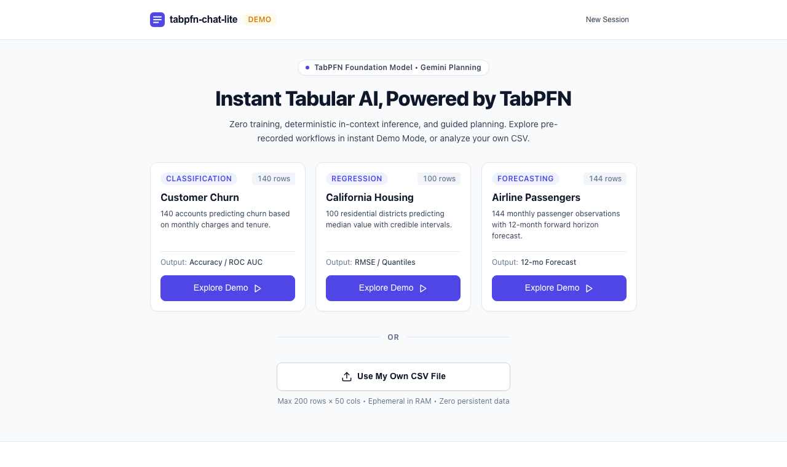
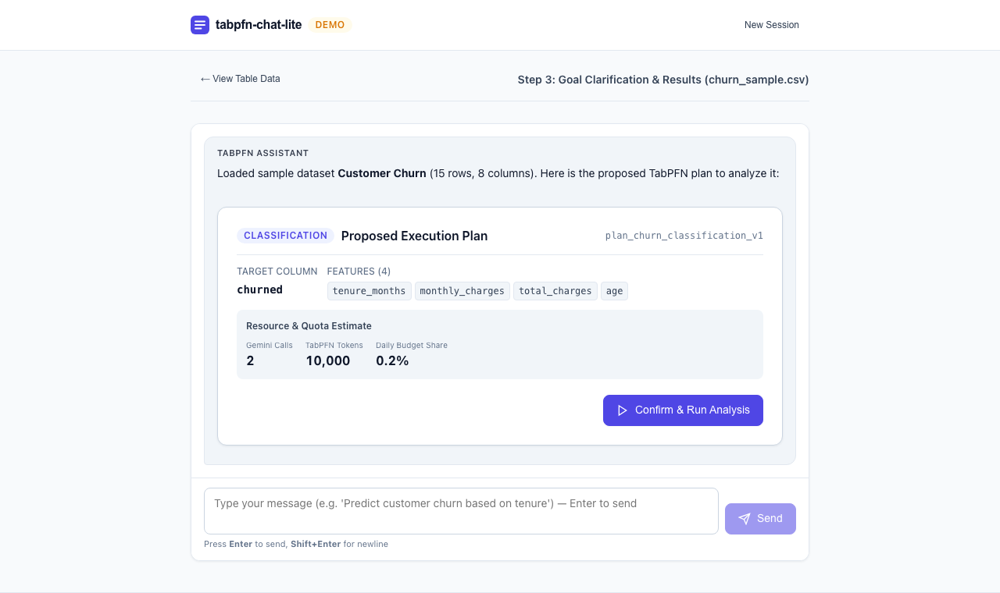
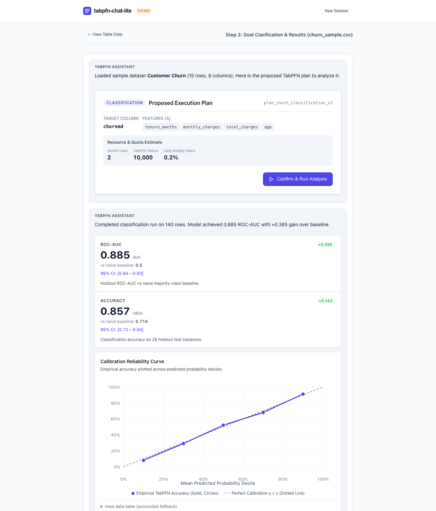
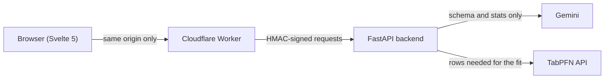
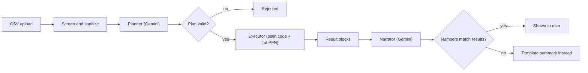

# tabpfn-chat-lite

Upload a small CSV, chat about what you want to find out, confirm a plan, and get metrics, charts and tables back.

Gemini does the talking: it clarifies your goal and writes the plan. Plain code does the work: it validates the plan, runs it through the [TabPFN](https://priorlabs.ai) API and produces every number you see. The model never gets to invent a result.

<!-- Live demo: add the URL here once deployed -->



## Why I built it

I wanted to see how small and cheap a "chat with your data" app can be if you refuse to trust the LLM with anything that matters. The constraints I set myself:

- Loads fast: under 40 KB of JS and CSS (gzipped), no UI kit, no chart library, no CDN.
- Free to run for a handful of simultaneous users.
- Works with no backend at all (demo mode), so anyone can try it instantly.
- Safe to expose publicly: signed gateway, input screening, nothing stored beyond the session.

## What it does

1. **Upload or pick a sample.** Files are screened for emails, phone numbers, ID numbers and card numbers in the browser and again on the server. Matches are refused.
2. **Chat.** Gemini asks what you want to predict and proposes a plan.
3. **Confirm.** The plan is a structured object, validated against a JSON schema, with a token estimate shown before anything runs.
4. **Results stream in.** Metrics against a naive baseline, charts, tables, a CSV download, then a short written summary.

| Plan | Results |
| :---: | :---: |
|  |  |

Supported plan types: classification, regression, forecasting, anomaly detection, data generation and interpretability. In live mode the TabPFN fit is a classification or regression call. The other four are covered by the plan contract, deterministic result builders and recorded demo runs, and are not yet wired to dedicated TabPFN endpoints.

## How it works



The Worker handles bot checks (Turnstile), per-IP and global daily limits, a kill switch and request signing. The backend only accepts signed requests (except `/health`) and keeps sessions in memory with a 30-minute TTL.

A single analysis goes through four steps:



### Decisions worth knowing about

- **LLM output is never trusted.** The planner's `Plan` must validate against [`contract/schemas/plan.json`](contract/schemas/plan.json) before the executor touches it. The executor makes zero LLM calls.
- **Numbers come from code.** Metrics and charts are built by deterministic emitters. A narrator guard checks the written summary against those results and swaps in a template if a number doesn't match.
- **Uploaded data is data, never instructions.** Column names and cell values are sanitized, length-capped and framed as data in prompts. Gemini sees column names, types, summary statistics and at most 3 sample values, never the table. TabPFN receives only the rows a fit needs. Cell values are never logged.
- **One contract, three consumers.** The OpenAPI spec, JSON schemas, error catalog and fixtures live in [`contract/`](contract). Backend, gateway and frontend are all tested against them (`contract/check.py`).
- **Replayable logs.** Every event is logged in order with a SHA-256 hash chain, and a run can be replayed offline without calling Gemini or TabPFN.
- **Host-agnostic.** Swapping the backend host is an environment variable, not a code change.

## Measured numbers

Measured on a MacBook (Apple silicon), Docker for the container figures.

| What | Budget | Measured |
| :--- | :--- | :--- |
| Initial JS + CSS (gzipped) | 50 KB | 39.97 KB |
| Chart kit, lazy loaded (gzipped) | 15 KB | 12.22 KB |
| Cloudflare Worker bundle (gzipped) | 100 KB | 13.71 KB |
| Docker image (uncompressed) | 400 MB | 360 MB |
| Backend idle memory (in container) | 200 MB | 68.59 MiB |
| Backend cold start (3 runs, avg) | 3 s | 620 ms |
| Layout shift (CLS) | n/a | 0.001 |
| Frame rate at 4x CPU throttle | n/a | 60.5 fps |
| Tests | n/a | 156 passing (134 pytest, 22 vitest) |

Budgets are enforced by `make verify`, along with the contract check and a secret scan.

## Run it locally

You need Python 3.12 with [uv](https://github.com/astral-sh/uv) and [Bun](https://bun.sh).

**Demo mode** (no keys, no backend):

```bash
make frontend-build
cd frontend && bun run preview
```

Open http://localhost:4173 and pick one of the sample datasets.

**Full checks** (tests, contract, size budgets, secret scan, security and load drills):

```bash
make verify
```

**Live mode** needs a Gemini API key and a TabPFN token:

```bash
cp .env.example .env        # then fill in GEMINI_API_KEY and TABPFN_TOKEN
uv run uvicorn tabchat.main:app --port 8000 --workers 1
```

Keys stay in `.env` (git-ignored) locally, and in the host's secret store when deployed. Sample CSVs for each capability are in [`demos/`](demos).

## Limits

- **Small tables only:** up to 200 rows, 50 columns and 1 MB. Text cells are capped at 64 characters.
- **Not for personal data.** Uploads that look like they contain emails, phone numbers, ID numbers or card numbers are refused. The screening is pattern-based, so unusual formats can slip through.
- **Free-tier quotas are small.** When I checked in October 2026, the Gemini free tier allowed 20 requests per day for the planner model, and the TabPFN free tier allowed 5,000,000 tokens per day. Both can change. When a quota runs out, the app falls back to demo mode.
- **Free Gemini keys may use prompts to improve Google's products.** That is why only schema and statistics are sent.
- **Cold starts.** On Render's free tier the backend sleeps after 15 minutes idle, and waking it takes 30 to 50 seconds. The gateway shows a "waking up" notice and offers demo mode meanwhile.
- **Single instance.** In-memory sessions and a strict queue keep memory low and API quotas safe, at the cost of scale.
- **Hosted TabPFN terms.** A public demo is fine under Prior Labs' API terms. A commercial product would need a commercial agreement with them.

## Stack

Svelte 5, Vite and strict TypeScript on the frontend with hand-rolled SVG charts. A Cloudflare Worker with a SQLite-backed Durable Object as the gateway. FastAPI and Pydantic on the backend, managed with uv. Gemini for planning and narration, TabPFN for predictions.

## License

[Apache 2.0](LICENSE). TabPFN API use is subject to [Prior Labs' terms](https://priorlabs.ai), and Gemini API use to [Google's API terms](https://ai.google.dev/terms).
